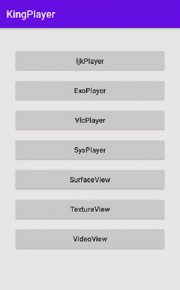

# KingPlayer

[](https://jitpack.io/#jenly1314/KingPlayer)
[](https://app.circleci.com/pipelines/github/jenly1314/KingPlayer)
[](https://raw.githubusercontent.com/jenly1314/KingPlayer/master/app/release/app-release.apk)
[](https://developer.android.com/guide/topics/manifest/uses-sdk-element#ApiLevels)
[](https://opensource.org/licenses/mit)


KingPlayer 一个专注于 Android 视频播放器（IjkPlayer、ExoPlayer、VlcPlayer、SysPlayer）的基础库，无缝切换内核。


## 功能说明
- [x] 主要播放相关核心功能
- [x] 播放器无缝切换
  - [x] MediaPlayer封装实现（SysPlayer）
  - [x] IjkPlayer封装实现
  - [x] ExoPlayer封装实现
  - [x] vlc-android封装实现
- [ ] 控制图层相关
  - [ ] 待补充...

## 效果展示


> 你也可以直接下载 [演示App](https://raw.githubusercontent.com/jenly1314/KingPlayer/master/app/release/app-release.apk) 体验效果

## 引入

### Gradle:

1. 在Project的 **build.gradle** 或 **setting.gradle** 中添加远程仓库

	```gradle
	repositories {
	  //...
	  mavenCentral()
	  maven { url 'https://jitpack.io' }
	}
	```

2. 在Module的 **build.gradle** 中添加依赖项

	使用 **SysPlayer** (Android自带的MediaPlayer)
	```gradle
	//KingPlayer基础库，内置SysPlayer
	implementation 'com.github.jenly1314.KingPlayer:king-player:1.0.0-beta1'
	```

	使用 **IjkPlayer**
	```gradle
	//KingPlayer基础库（必须）
	implementation 'com.github.jenly1314.KingPlayer:king-player:1.0.0-beta1'
	//IjkPlayer
	implementation 'com.github.jenly1314.KingPlayer:ijk-player:1.0.0-beta1'

	// 根据您的需求选择ijk模式的so
	implementation 'tv.danmaku.ijk.media:ijkplayer-armv7a:0.8.8'
	// Other ABIs: optional
	implementation 'tv.danmaku.ijk.media:ijkplayer-armv5:0.8.8'
	implementation 'tv.danmaku.ijk.media:ijkplayer-arm64:0.8.8'
	implementation 'tv.danmaku.ijk.media:ijkplayer-x86:0.8.8'
	implementation 'tv.danmaku.ijk.media:ijkplayer-x86_64:0.8.8'

	```

	使用 **ExoPlayer**
	```gradle
	//KingPlayer基础库（必须）
	implementation 'com.github.jenly1314.KingPlayer:king-player:1.0.0-beta1'
	//ExoPlayer
	implementation 'com.github.jenly1314.KingPlayer:exo-player:1.0.0-beta1'
	```

	使用 **VlcPlayer**
	```gradle
	//KingPlayer基础库（必须）
	implementation 'com.github.jenly1314.KingPlayer:king-player:1.0.0-beta1'
	//VlcPlayer
	implementation 'com.github.jenly1314.KingPlayer:vlc-player:1.0.0-beta1'
	```

## 使用

布局示例
```xml
    <com.king.player.kingplayer.view.VideoView
        android:id="@+id/videoView"
        android:layout_width="match_parent"
        android:layout_height="match_parent" />
```

代码示例
```kotlin
        //初始化一个视频播放器（IjkPlayer、ExoPlayer、VlcPlayer、SysPlayer）
        videoView.player = IjkPlayer(context)
        //初始化数据源
        val dataSource = DataSource(url)
        videoView.setDataSource(dataSource)

        videoView.setOnSurfaceListener(object : VideoView.OnSurfaceListener {
            override fun onSurfaceCreated(surface: Surface, width: Int, height: Int) {
                LogUtils.d("onSurfaceCreated: $width * $height")
                videoView.start()
            }

            override fun onSurfaceSizeChanged(surface: Surface, width: Int, height: Int) {
                LogUtils.d("onSurfaceSizeChanged: $width * $height")
            }

            override fun onSurfaceDestroyed(surface: Surface) {
                LogUtils.d("onSurfaceDestroyed")
            }

        })

        //缓冲更新监听
        videoView.setOnBufferingUpdateListener {
            LogUtils.d("buffering: $it")
        }
        //播放事件监听
        videoView.setOnPlayerEventListener { event, bundle ->

        }
        //错误事件监听
        videoView.setOnErrorListener { event, bundle ->

        }
        


```
```kotlin
        
        //------------ 控制相关
        //开始
        videoView.start()
        //暂停
        videoView.pause()
        //进度调整到指定位置
        videoView.seekTo(pos)
        //停止
        videoView.stop()
        //释放
        videoView.release()
        //重置
        videoView.reset()
```

更多使用详情，请查看[app](app)中的源码使用示例或直接查看[API帮助文档](https://jitpack.io/com/github/jenly1314/KingPlayer/latest/javadoc/)


### 其他

需使用JDK8+编译，在你项目中的build.gradle的android{}中添加配置：

```gradle
compileOptions {
    targetCompatibility JavaVersion.VERSION_1_8
    sourceCompatibility JavaVersion.VERSION_1_8
}

```

## 相关推荐
- [ImageViewer](https://github.com/jenly1314/ImageViewer) 一个图片查看器，一般用来查看图片详情或查看大图时使用。
- [CameraScan](https://github.com/jenly1314/CameraScan) 一个简化扫描识别流程的通用基础库。
- [LibYuv](https://github.com/jenly1314/LibYuv) 基于Google的libyuv编译封装的YUV转换工具库，主要用途是在各种YUV与RGB之间进行相互转换、裁减、旋转、缩放、镜像等。
- [ZXingLite](https://github.com/jenly1314/ZXingLite) 基于zxing实现的扫码库，优化扫码和生成二维码/条形码功能。
- [MLKit](https://github.com/jenly1314/MLKit) 一个强大易用的工具包。通过ML Kit您可以很轻松的实现文字识别、条码识别、图像标记、人脸检测、对象检测等功能。
- [WeChatQRCode](https://github.com/jenly1314/WeChatQRCode) 基于OpenCV开源的微信二维码引擎移植的扫码识别库。


## 版本日志

#### v1.0.0-beta1：2020-12-28
*  KingPlayer初始版本

## 感谢
- [ijkPlayer](https://github.com/bilibili/ijkplayer)
- [ExoPlayer](https://github.com/google/ExoPlayer)
- [vlc-android](https://code.videolan.org/videolan/vlc-android)
- [MediaPlayer](https://android.googlesource.com/platform/frameworks/base/+/refs/heads/master/media/java/android/media/MediaPlayer.java)

---


   
